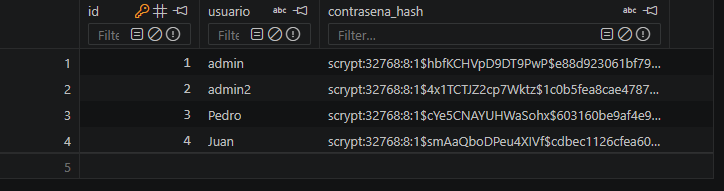

<h1 align="center">Proyecto Flask MVC · Login y CRUD</h1>

<p align="center">
  
</p>

<p align="center">
  
  
  
  
  
  
</p>

<p align="center"><i>"Tú pones las ganas, nosotros cuadramos"</i></p>

---

## 📑 Índice

* [Descripción del proyecto](#-descripción-del-proyecto)
* [Estado del proyecto](#-estado-del-proyecto)
* [Funcionalidades y demostración](#-funcionalidades-y-demostración)
* [Arquitectura MVC](#-arquitectura-mvc)
* [Seguridad](#-seguridad)
* [Acceso al proyecto](#-acceso-al-proyecto)
* [Abre y ejecuta el proyecto](#️-abre-y-ejecuta-el-proyecto)
* [Tecnologías utilizadas](#-tecnologías-utilizadas)
* [Persona desarrolladora](#-persona-desarrolladora)
* [Licencia](#-licencia)
* [Conclusión](#-conclusión)

---

## 📝 Descripción del proyecto

Aplicación web desarrollada con **Flask** aplicando el patrón de arquitectura **MVC (Modelo – Vista – Controlador)**. Incluye un sistema de **autenticación** con usuario y contraseña y una **sección protegida** donde se realiza el **CRUD** (Crear, Leer, Actualizar y Eliminar) de usuarios.

El proyecto toma como concepto a **Cuadra**, una plataforma pensada para conectar deportistas que necesitan un compañero para jugar o entrenar. Esta primera versión implementa la base del sistema: la gestión de usuarios y su autenticación.

**Objetivos cumplidos:**

* Aplicar el patrón MVC separando modelos, vistas y controladores.
* Implementar las cuatro operaciones CRUD sobre una entidad.
* Proteger las URLs de la sección privada para que no sean accesibles sin iniciar sesión.
* Guardar las contraseñas de forma segura (hash), nunca en texto plano.

---

## 🚦 Estado del proyecto

<h4 align="center">✅ Versión 1.0 finalizada: login, registro, CRUD de usuarios y rutas protegidas ✅</h4>

Próximas mejoras planeadas: perfiles deportivos, publicaciones de "busco compañero" y emparejamiento entre usuarios.

---

## 🔨 Funcionalidades y demostración

* `Inicio de sesión`: acceso con usuario y contraseña. Si los datos son incorrectos, se muestra un mensaje de error.
* `Registro`: cualquier persona puede crear su propia cuenta desde la pantalla de inicio.
* `Cerrar sesión`: finaliza la sesión y bloquea de nuevo la sección protegida.
* `Gestión de usuarios (CRUD)`, disponible solo con sesión iniciada:
  * `Crear`: agregar nuevos usuarios desde el panel.
  * `Leer`: ver el listado de usuarios registrados.
  * `Actualizar`: editar el nombre de usuario o la contraseña. Si la contraseña se deja vacía, se mantiene la anterior.
  * `Eliminar`: borrar usuarios, con confirmación previa. Un usuario no puede eliminarse a sí mismo.
* `Rutas protegidas`: si alguien intenta entrar a una URL privada sin sesión, es redirigido al login.
* `Mensajes de retroalimentación`: avisos de éxito, error y advertencia en cada acción.
* `Diseño responsive`: se adapta a computadora, tablet y celular.

### 🎥 Video de demostración

[Ver el video de demostración](https://youtu.be/l8h2Tvn1OgM)

### 📸 Capturas

| Inicio de sesión | Registro |
| :---: | :---: |
|  |  |

| Gestión de usuarios | Contraseñas hasheadas en la base de datos |
| :---: | :---: |
|  |  |

---

## 🧱 Arquitectura MVC

```
proyecto-mvc-crud-login/
├── app.py                      # Punto de entrada: crea la app y registra los controladores
├── config.py                   # Configuración (clave secreta y base de datos)
├── extensions.py               # Instancias de SQLAlchemy y Flask-Login
├── requirements.txt            # Dependencias del proyecto
│
├── models/                     # MODELO: datos y reglas de negocio
│   └── usuario.py              # Tabla "usuarios" y manejo del hash de la contraseña
│
├── controllers/                # CONTROLADOR: reciben las peticiones y deciden qué hacer
│   ├── auth_controller.py      # Login, registro y cierre de sesión
│   └── usuario_controller.py   # CRUD de usuarios (rutas protegidas)
│
├── templates/                  # VISTA: plantillas HTML (Jinja2 + Bootstrap)
│   ├── index.html              # Inicio de sesión
│   ├── registro.html           # Registro de cuenta
│   ├── base.html               # Plantilla base del panel (barra lateral)
│   └── usuarios/
│       ├── lista.html          # Listado de usuarios
│       └── formulario.html     # Formulario para crear y editar
│
└── static/                     # Archivos estáticos
    ├── css/style.css           # Estilos propios
    └── img/logo.png            # Logo
```

| Capa | Responsabilidad |
| --- | --- |
| **Modelo** | Define la tabla `usuarios` y cómo se guarda y verifica la contraseña. |
| **Vista** | Muestra la información al usuario con plantillas Jinja2 y Bootstrap. |
| **Controlador** | Recibe cada petición, consulta o modifica el modelo y elige qué vista mostrar. |

### Rutas de la aplicación

| Método | Ruta | Descripción | ¿Protegida? |
| --- | --- | --- | :---: |
| GET / POST | `/` | Inicio de sesión | No |
| GET / POST | `/registro` | Registro de cuenta | No |
| GET | `/logout` | Cerrar sesión | Sí |
| GET | `/usuarios/` | Listar usuarios | Sí |
| GET / POST | `/usuarios/crear` | Crear usuario | Sí |
| GET / POST | `/usuarios/editar/<id>` | Editar usuario | Sí |
| POST | `/usuarios/eliminar/<id>` | Eliminar usuario | Sí |

---

## 🔐 Seguridad

### Contraseñas hasheadas

Las contraseñas **nunca se guardan en texto plano**. El modelo `Usuario` usa las funciones de seguridad de **Werkzeug** (la biblioteca sobre la que funciona Flask):

```python
def set_contrasena(self, contrasena):
    self.contrasena_hash = generate_password_hash(contrasena)

def verificar_contrasena(self, contrasena):
    return check_password_hash(self.contrasena_hash, contrasena)
```

* `generate_password_hash` convierte la contraseña en un hash con el algoritmo **scrypt** y una **sal aleatoria**.
* `check_password_hash` compara la contraseña escrita en el login con el hash guardado, sin necesidad de descifrarlo.

En la base de datos, la contraseña `1234` se guarda de esta forma:

```
scrypt:32768:8:1$hbfKCHVpD9DT9PwP$e88d923061bf79...
```

> **¿Por qué scrypt y no MD5?** MD5 no usa sal y es muy rápido de calcular, por lo que hoy se considera inseguro para contraseñas. Scrypt es lento a propósito y genera un hash distinto para cada usuario, aunque dos personas usen la misma contraseña.

### Rutas protegidas

Todas las rutas del CRUD llevan el decorador `@login_required` de **Flask-Login**:

```python
@usuarios_bp.route("/")
@login_required
def listar():
```

Si alguien sin sesión intenta entrar a una de estas URLs (por ejemplo, desde una ventana de incógnito), la ruta no se ejecuta y el usuario es redirigido al login con el aviso *"Inicia sesión para acceder a esta página"*.

La sesión se guarda en una cookie firmada con la `SECRET_KEY` definida en `config.py`, por lo que no puede falsificarse.

---

## 📁 Acceso al proyecto

Clona el repositorio:

```bash
git clone https://github.com/Alejo2442/proyecto-mvc-crud-login.git
cd proyecto-mvc-crud-login
```

O descárgalo como ZIP desde el botón **Code → Download ZIP** de esta página.

---

## 🛠️ Abre y ejecuta el proyecto

**Requisitos:** Python 3.10 o superior.

1. **Crea y activa un entorno virtual**

   ```bash
   python -m venv venv
   ```

   Windows:
   ```bash
   venv\Scripts\activate
   ```

   macOS / Linux:
   ```bash
   source venv/bin/activate
   ```

2. **Instala las dependencias**

   ```bash
   pip install -r requirements.txt
   ```

3. **Ejecuta la aplicación**

   ```bash
   python app.py
   ```

4. **Abre el navegador** en [http://127.0.0.1:5000](http://127.0.0.1:5000)

La base de datos `cuadra.db` se crea automáticamente la primera vez, junto con un usuario administrador de prueba:

| Usuario | Contraseña |
| --- | --- |
| `admin` | `admin123` |

> En Windows, si al activar el entorno aparece un error de "ejecución de scripts deshabilitada", ejecuta una vez `Set-ExecutionPolicy -Scope CurrentUser RemoteSigned`.

---

## 💻 Tecnologías utilizadas

| Tecnología | Uso en el proyecto |
| --- | --- |
| **Python** | Lenguaje principal |
| **Flask** | Framework web: rutas, controladores y plantillas |
| **Flask-SQLAlchemy** | ORM para trabajar con la base de datos usando clases de Python |
| **Flask-Login** | Manejo de la sesión y protección de rutas |
| **Werkzeug** | Hash seguro de contraseñas (scrypt) |
| **SQLite** | Base de datos en un solo archivo |
| **Jinja2** | Motor de plantillas de las vistas |
| **Bootstrap 5** | Diseño responsive, grilla, formularios y componentes |
| **Bootstrap Icons** | Íconos del panel |
| **Google Fonts (Montserrat)** | Tipografía de la marca |

---

## 👤 Persona desarrolladora

| [<br><sub>Alejandro Martínez</sub>](https://github.com/Alejo2442) |
| :---: |

Proyecto desarrollado para la materia de **Ingeniería Web**.

---

## 📄 Licencia

Este proyecto está bajo la licencia **MIT**. Consulta el archivo [LICENSE](LICENSE) para más detalles.

---

## ✅ Conclusión

Este proyecto demuestra cómo organizar una aplicación Flask con el patrón **MVC**, implementar un **CRUD** completo y protegerlo con un sistema de **autenticación**. Las contraseñas se guardan con un hash seguro y las rutas privadas no son accesibles sin iniciar sesión. Sobre esta base se construirán las siguientes funciones de Cuadra.
